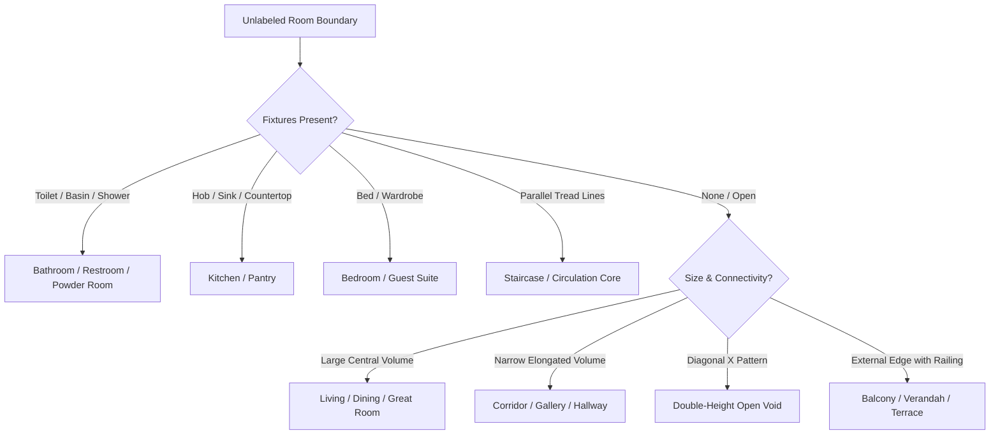

# Architectural Reasoning & Spatial Analysis Guide

This guide details how an experienced architect mentally decomposes, analyzes, and interprets raw CAD drawings prior to rendering.

---

## 1. Structural & Geometric Decomposition

### 1.1 Wall Hierarchy & Reading Lines
- **Primary Structural Enclosure (External Walls)**: Typically 200mm–300mm (8"–12") thick. These establish thermal boundary, external weathering, and structural perimeter. In rendering, they receive the highest visual contrast and deepest drop shadows.
- **Internal Partition Walls**: Typically 100mm–150mm (4"–6") thick. These separate internal acoustic and functional zones.
- **Structural Columns & Load-Bearing Piers**: Located at grid intersections, corners, and major load transfer points. Identified as rectangular/square closed profiles, often highlighted with column caps or distinct color accenting (`#B8A040`).

### 1.2 Openings (Fenestration & Doors)
- **Hinged Single-Leaf Doors**: Drawn as a perpendicular or angled leaf line with a quarter-circle swing arc representing clearance radius.
- **Double Doors**: Symmetrical dual-arc swings, commonly used at main entry foyers or formal balconies.
- **Sliding Glazed Doors**: Overlapping parallel line segments inside external wall recesses leading to terraces or gardens.
- **Windows**: Multi-line parallel strokes within wall reveals. Glazing is rendered with a cool cyan/teal accent line to communicate transparency and daylight ingress.

---

## 2. Room Typology Inference Heuristics

When floor plans lack explicit text room labels (common in architectural CAD exports), room typologies must be deduced using **fixture co-occurrence, spatial proportion, and circulation topology**:

### Detailed Fixture Analysis Matrix:
| Inferred Room Type | Key Fixture / Symbol Indicators | Spatial Position | Typical Size Range ($m^2$) |
| :--- | :--- | :--- | :--- |
| **Kitchen** | L-shaped or parallel counters, circular hob burners, rectangular sink basin | Adjacent to dining / service access | 10 – 25 |
| **Powder Room** | WC basin, small hand-wash sink only | Near entrance or public living zone | 2.5 – 5 |
| **Master Bath** | Dual vanity, WC, walk-in shower or bathtub | Directly attached to Master Bedroom | 6 – 15 |
| **Master Bedroom** | King/Queen bed footprint, bedside tables, extensive wardrobe bank | Quiet perimeter, optimal daylight orientation | 18 – 35 |
| **Living Room** | Sectional sofa, coffee table, media unit footprint | Direct connection to entrance foyer and dining | 25 – 60 |
| **Formal Dining** | 6-to-10 seater rectangular or circular table with chairs | Intermediate between kitchen and living | 15 – 30 |
| **Vertical Core** | Parallel stair treads with arrow, lift/elevator shaft | Central structural core or foyer edge | 8 – 20 |
| **Open Void** | Crossed diagonal dashed lines ($X$) | Adjacent to upper floor circulation | 10 – 30 |

---

## 3. Circulation & Egress Verification

1. **Primary Circulation Axis**: Trace the path from the exterior entry door through foyers and corridors to all habitable spaces. Corridors must maintain a minimum clear width of $1.0m$ to $1.2m$ without furniture intrusion.
2. **Door Clearances**: Never place rugs, furniture, or ornamental plants within the radius of a door swing arc.
3. **Wet Area Thresholds**: Bathrooms, laundry rooms, and kitchens should clearly show entry doors swinging inward against an adjacent wall, leaving vanity and fixture circulation clear.

---

## 4. Multi-Level Coherence Check

For multi-storey projects (such as the 3-floor DIRECTOR residence):
1. **Vertical Alignment**: Ensure the staircase core, elevator shafts, plumbing chases, and exterior structural walls align precisely across Ground, First, and Second floors.
2. **Double-Height Voids**: Cross-verify that the open void on upper floors directly overlooks the intended living or foyer zone on the floor below.
3. **Terrace Overhangs**: Verify that balconies and cantilevers correspond structurally to the floor below.

---

## 5. Boundary Delineation: Isolating Built Footprint from Technical Annotation Collars

A critical requirement in professional architectural plan rendering is distinguishing between the **internal habitable space** and the **external technical annotation collar**:

### 5.1 Anatomical Distinction
1. **The Built Footprint**:
   - Demarcated by the exterior structural wall perimeter (typically $200\text{mm} - 300\text{mm}$ masonry or concrete).
   - Contains all internal partitions, rooms, doors, windows, courtyards, and bounded balconies.
   - **Rule**: All realistic floor finishes (French oak parquet, Calacatta marble, sage quartzite, slate, and patio pavers) belong *strictly* within this perimeter.
2. **The Exterior Annotation Collar**:
   - Lies immediately outside the exterior structural walls.
   - Contains dimension strings, witness lines, dimension text (`4.89 m`, `5.50 m`), section arrows ($A-A'$), grid bubbles ($A, B, C / 1, 2, 3$), and title notes.
   - **Rule**: This zone must remain pristine `#F7FBFE` presentation off-white. No floor finishes or wall poupés may spill into this zone under any circumstance.

### 5.2 Algorithmic Isolation Protocol
1. **Morphological Wall Closure**: Close openings along the exterior boundary using a $4 \times \text{scale}$ structuring element to form an uninterrupted perimeter boundary.
2. **Connected Component Filtering**: Internal rooms are bounded components that do not touch the image borders. The union of these rooms plus wall thickness constitutes the `solid_envelope`.
3. **Strict Spatial Intersect**: Every material mask is intersected with `solid_envelope`. Any candidate pixel outside `solid_envelope` is zeroed out.
4. **Dimension Protection**: Dimension lines and callouts are superimposed on the clean off-white collar as sharp vector lines with 100% legibility and zero dilation.
5. **Intelligent Plan Framing**: Calculate the bounding box of `solid_envelope` + dimension collar (with $10-15\%$ margin) and auto-crop the drawing, removing extraneous empty paper margins before presentation sheet assembly.
