# Pipeline Technical Reference Manual

Detailed technical specifications, data schemas, and API contracts for the automated architectural plan rendering pipeline.

---

## 1. Pipeline Overview

```mermaid
flowchart LR
    P1["extract_pdf.py\n(PyMuPDF)"] -->|JSON Drawing Primitives| P2["analyze_geometry.py\n(OpenCV & Shapely)"]
    P2 -->|Architectural Model JSON| P3["Claude Semantic\nReasoning Engine"]
    P3 -->|Enriched Model JSON| P4["render_plan.py\n(Pillow Layer Engine)"]
    P4 -->|Rendered Floor Images| P5["compose_sheet.py\n(Sheet Builder)"]
    P5 -->|Presentation PDF & PNG| P6["validate_output.py\n(QA Engine)"]
```



---

## 2. JSON Data Schemas

### 2.1 Extracted Raw Primitives (`raw_primitives.json`)
Produced by `extract_pdf.py`:
```json
{
  "source_file": "DIRECTOR PL PLAN 150.pdf",
  "page_index": 0,
  "page_width_pts": 792.0,
  "page_height_pts": 612.0,
  "scale_hint": "1:150",
  "paths": [
    {
      "type": "stroke",
      "color": [0.0, 0.0, 0.0],
      "width": 0.24,
      "items": [
        ["l", [335.0, 275.3], [377.6, 275.3]]
      ]
    }
  ],
  "text_blocks": [
    {
      "text": "4.89 m",
      "bbox": [628.3, 275.3, 638.5, 283.0],
      "size": 6.8
    }
  ]
}
```

### 2.2 Architectural Model (`architectural_model.json`)
Produced by `analyze_geometry.py` and enriched by semantic reasoning:
```json
{
  "project_name": "DIRECTOR",
  "level": "GROUND_FLOOR",
  "bounds": [100.0, 50.0, 700.0, 550.0],
  "walls": [
    {
      "id": "wall_ext_01",
      "type": "external",
      "thickness_pts": 8.5,
      "polygon": [[120.0, 100.0], [450.0, 100.0], [450.0, 108.5], [120.0, 108.5]]
    }
  ],
  "openings": [
    {
      "id": "door_01",
      "type": "single_swing",
      "location": [245.0, 100.0],
      "width_pts": 25.0,
      "swing_angle": 90
    },
    {
      "id": "win_01",
      "type": "double_glazed",
      "location": [350.0, 100.0],
      "width_pts": 40.0
    }
  ],
  "rooms": [
    {
      "id": "room_01",
      "semantic_type": "BEDROOM",
      "subtype": "MASTER_BEDROOM",
      "material_key": "WOOD_PARQUET_HERRINGBONE",
      "area_sq_m": 24.5,
      "polygon": [[128.5, 108.5], [300.0, 108.5], [300.0, 250.0], [128.5, 250.0]],
      "fixtures": ["bed_double", "nightstand_pair", "wardrobe"]
    },
    {
      "id": "room_02",
      "semantic_type": "KITCHEN",
      "material_key": "STONE_VERDE_SAGE",
      "area_sq_m": 16.2,
      "polygon": [[310.0, 108.5], [440.0, 108.5], [440.0, 250.0], [310.0, 250.0]],
      "fixtures": ["counter_l_shaped", "cooktop_4_burner", "sink_double"]
    }
  ],
  "annotations": {
    "dimensions": [
      {
        "text": "4.89 m",
        "p1": [628.3, 275.3],
        "p2": [677.2, 275.3],
        "orientation": "horizontal"
      }
    ]
  }
}
```

---

## 3. Script Invocations & CLI Interface

### 3.1 `extract_pdf.py`
```bash
python scripts/extract_pdf.py --input "samples/DIRECTOR PL PLAN 150.pdf" --output "samples/extracted_pl.json"
```

### 3.2 `analyze_geometry.py`
```bash
python scripts/analyze_geometry.py --input "samples/extracted_pl.json" --output "samples/model_pl.json" --dpi 300
```

### 3.3 `render_plan.py`
```bash
python scripts/render_plan.py --model "samples/model_pl.json" --output "samples/rendered_pl.png" --scale 4.1667
```

### 3.4 `compose_sheet.py`
```bash
python scripts/compose_sheet.py \
  --plans "samples/rendered_pl.png" "samples/rendered_fl.png" "samples/rendered_sl.png" \
  --template "assets/templates/sheet_a1.json" \
  --output "samples/DIRECTOR_PRESENTATION_SHEET.pdf"
```

### 3.5 `validate_output.py`
```bash
python scripts/validate_output.py \
  --source-vector "samples/DIRECTOR PL PLAN 150.pdf" \
  --rendered-raster "samples/rendered_pl.png" \
  --tolerance-px 2
```
