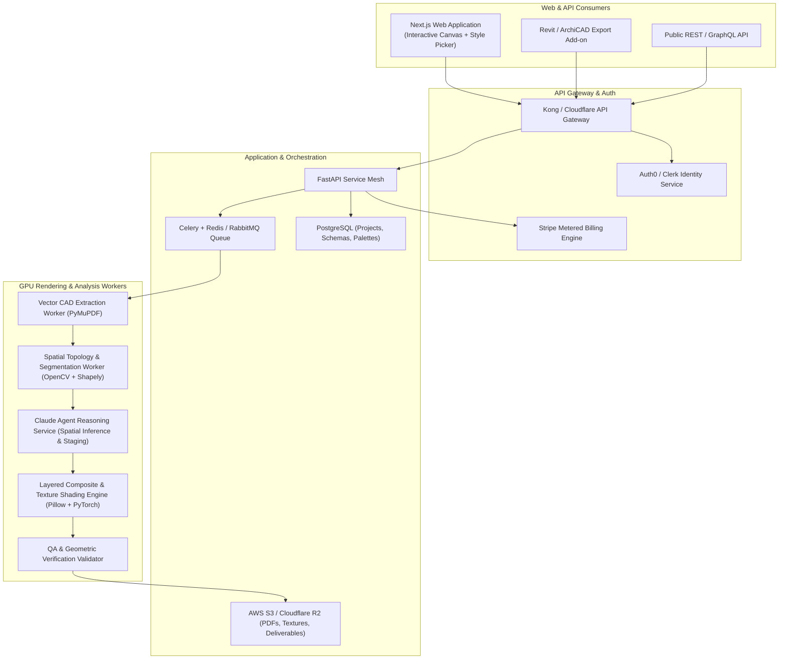
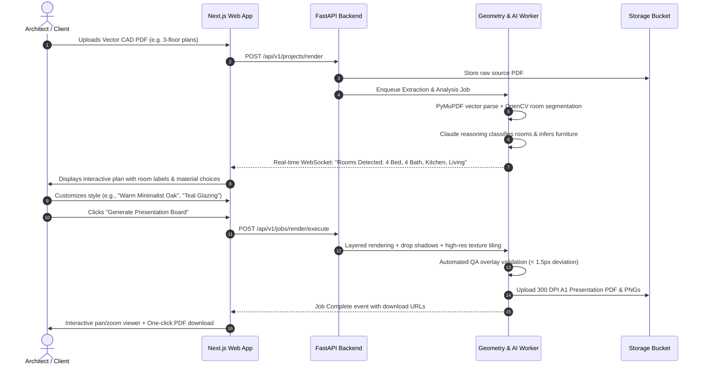

# SaaS Platform Architecture & Evolution Strategy

This specification details how the **Architectural Plan Renderer** Claude Skill transitions into the core intelligence layer of a scalable, multi-tenant B2B/B2C SaaS platform: **Renderize.ai**.

---

## 1. System Vision & Value Proposition

- **Target Audience**: Architects, interior designers, real estate developers, CAD drafters, real estate marketing agencies.
- **Problem**: Manually rendering black-and-white CAD floor plans in Photoshop or 3ds Max takes 4–8 hours per sheet and costs $150–$400 per plan.
- **Solution**: Instant, AI-driven architectural plan rendering in under 3 minutes with guaranteed geometric accuracy, customizable material palettes, and print-ready multi-page presentation boards.

---

## 2. Multi-Tier Microservices Architecture

---

## 3. End-to-End User Experience Lifecycle

---

## 4. Key Platform Features

### 4.1 Interactive Spatial Review & Editor
- Architects can review detected rooms before final rendering.
- Quick override dropdown (e.g., change "Study" to "Bedroom" or switch parquet from "Herringbone" to "Linear Plank").
- Live material palette swap with instant thumbnail preview.

### 4.2 Presentation Board Layout Generator
- Multi-sheet templates (A1, A2, Arch D, 16:9 Landscape) with configurable layouts:
  - 3-Floor Villa Stack (Ground, First, Second + Section AA' + Roof).
  - Apartment Comparison Board (2-BHK vs 3-BHK).
  - Title block customizer with firm logo, project area, scale, and north indicator.

### 4.3 Enterprise API & CAD Integrations
- Direct export from AutoCAD, Revit, and ArchiCAD via desktop plugin.
- Headless API for real estate property listing portals (Zillow, Rightmove, 99acres) to auto-render developer blueprints into attractive listing graphics.
